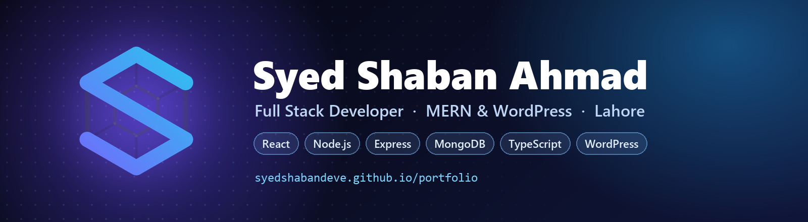

  

  
  
  
  

### About

I build web applications and client websites, mostly in React, Node and Express with MongoDB behind them, and in WordPress when a CMS is the right fit.

- MERN Stack Developer at **Sani IT-Consultant**, Lahore, since January 2024. I started there as a frontend intern in 2023.
- Freelancing since 2022 for clients in Pakistan, the UAE and the United States: builds, hosting, DNS, migrations and the fixes after launch.
- BS Computer Science at Riphah International University, in progress, after an Associate Degree in Information Technology there (2025).
- Open to full stack, MERN and WordPress roles, remote or on-site.

### Tech stack

**Frontend**

**Backend**

**CMS and tooling**

### Live client websites

| Site | What it is |
| --- | --- |
| **[thetimesofnewyork.com](https://thetimesofnewyork.com)** | News and publishing site with category sections, an article workflow and an admin dashboard for the editorial team |
| **[saniitconsultant.com](https://saniitconsultant.com)** | Website for a Dubai digital marketing agency: service pages, lead capture forms and on-page SEO |
| **[unitedstatesofdollars.com](https://unitedstatesofdollars.com)** | Site for an investment firm: business deals, certification and FAQ pages, with a live currency ticker |
| **[uforuae.com](https://uforuae.com)** | Business directory and listings portal for UAE clients, currently being relaunched |

### Projects

| Project | What it is | Stack |
| --- | --- | --- |
| **[Nexora](https://github.com/SyedShabanDeve/nexora)** · [site](https://syedshabandeve.github.io/nexora/) | Desktop workspace for Windows and macOS where four agents read files, run commands and answer out loud | Electron · React · TypeScript |
| **[Catchy Storefront](https://github.com/SyedShabanDeve/catchy-storefront)** · [live demo](https://syedshabandeve.github.io/catchy-storefront/) | Storefront with a variant-aware persistent cart, nested category routing, checkout and a homepage admin panel | React 19 · Router · Context · Tailwind |
| **[Sani Corporate Website](https://github.com/SyedShabanDeve/sani-corporate-website)** | Seven-page corporate site, every inner page lazy-loaded into its own chunk, with hash-aware scroll restoration | React 19 · Code splitting · Netlify |
| **[Directory Landing Redesign](https://github.com/SyedShabanDeve/directory-landing-redesign)** | Landing page redesign for a business directory: composite search bar, staggered motion, mobile-first | React · Framer Motion · Tailwind |
| **[FOLD&CARRY](https://github.com/SyedShabanDeve/foldandcarry)** | Storefront for a slim-wallet brand with WhatsApp ordering and cash on delivery across Pakistan | JavaScript · HTML · CSS |
| **[Portfolio](https://github.com/SyedShabanDeve/portfolio)** · [live](https://syedshabandeve.github.io/portfolio/) | A tesseract rotating in four dimensions and projected into 3D in real time, with four colour themes | React · three.js · GSAP · GLSL |

### Get in touch

- **Email:** [syedshaban785@gmail.com](mailto:syedshaban785@gmail.com)
- **LinkedIn:** [linkedin.com/in/syedshaban785](https://www.linkedin.com/in/syedshaban785)
- **Portfolio:** [syedshabandeve.github.io/portfolio](https://syedshabandeve.github.io/portfolio/)
- **Location:** Lahore, Pakistan, available for remote work
